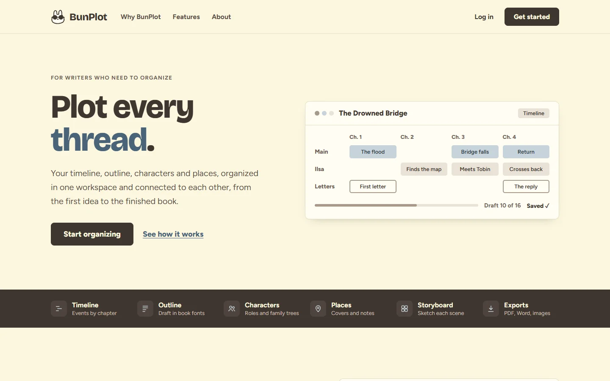
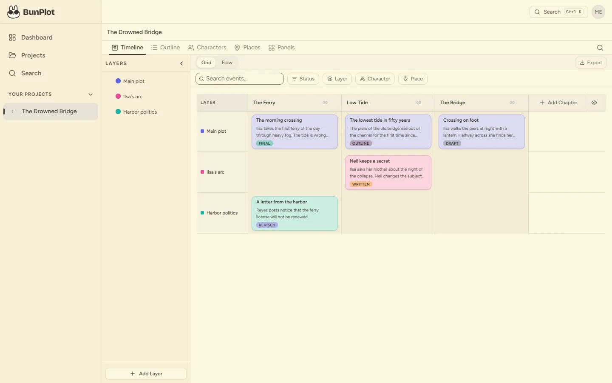
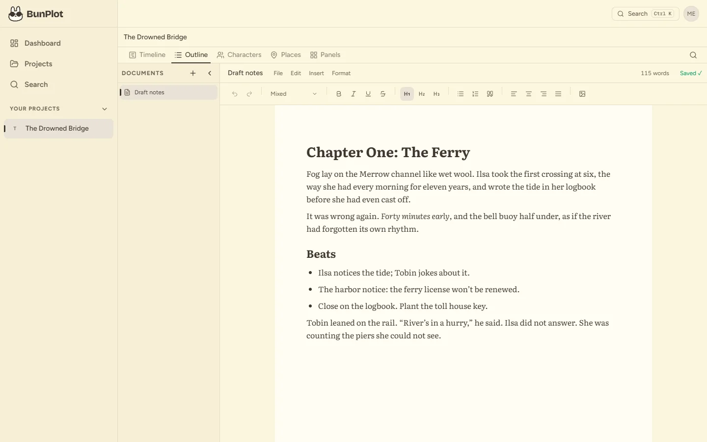
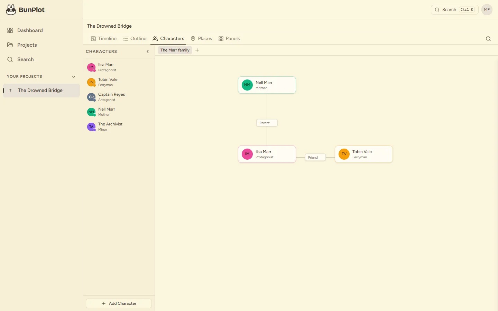
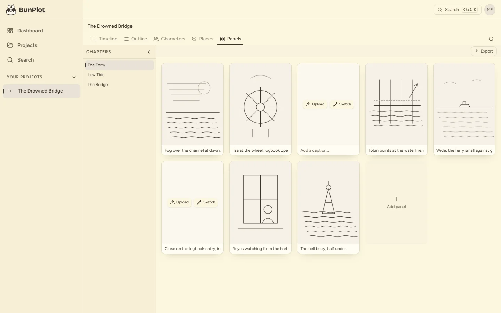
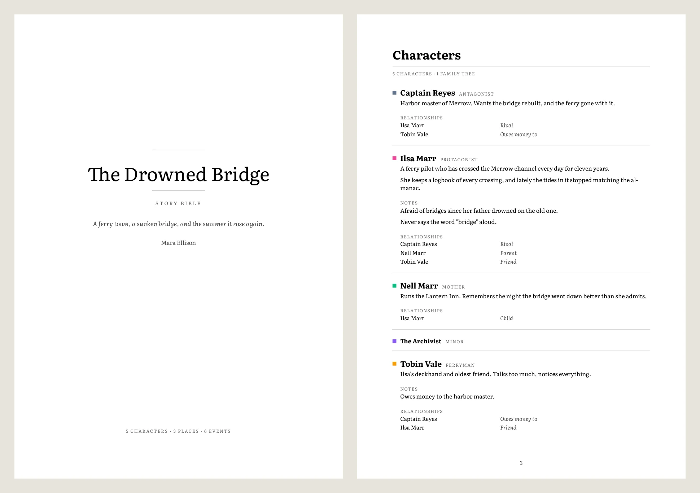
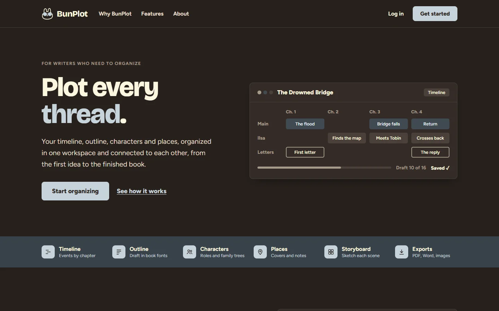
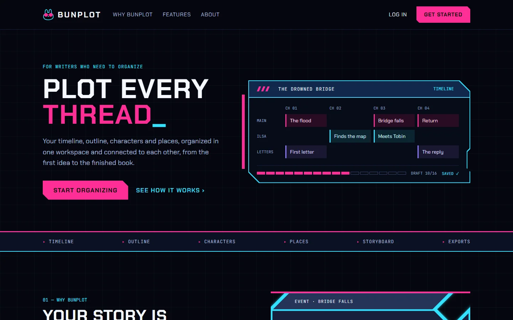
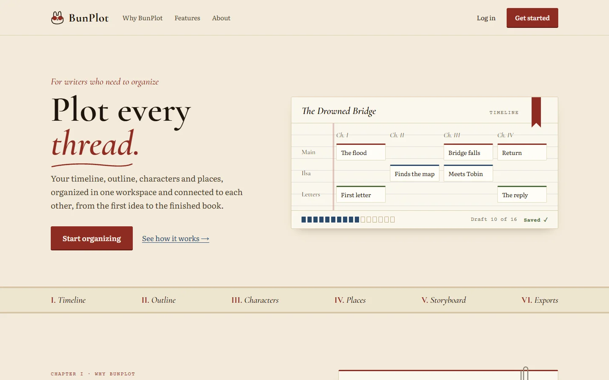

# BunPlot

BunPlot is a planning workspace for novelists. It keeps a story's timeline, outline, characters, places and storyboard in one place, connected to each other, and turns them into a printable story bible, a manuscript or a storyboard whenever you need one.

**Live:** [bun-plot.vercel.app](https://bun-plot.vercel.app)



## Features

- **Timeline:** events laid out by chapter and layer (plot, character arcs, subplots), with statuses, filters, a grid and a flow view, and drag to reorder.
- **Outline:** a rich-text editor for drafts and notes, with images, book fonts and autosave.
- **Characters:** profiles, relationship maps and family trees.
- **Places:** cover images, types, descriptions and notes.
- **Storyboard:** a panel grid per chapter, with image uploads and a built-in sketch pad.
- **Exports:** a story bible (PDF or Word), manuscripts in Standard or Book style (PDF or Word), and storyboards (PDF or a ZIP of images).
- **Search** across projects, a command menu, project folders, archive and duplicate.

| Timeline | Outline |
|---|---|
|  |  |
| **Characters** | **Storyboard** |
|  |  |

The story bible export, set like a printed book's appendix:



## Tech stack

- [Next.js 16](https://nextjs.org) (App Router, server actions), React 19 and TypeScript
- [Tailwind CSS 4](https://tailwindcss.com) with [shadcn/ui](https://ui.shadcn.com) on Radix
- [Supabase](https://supabase.com): Postgres, Auth and Storage, with Realtime for live updates
- [Tiptap](https://tiptap.dev) for rich text, [dnd-kit](https://dndkit.com) for drag and drop
- [react-pdf](https://react-pdf.org) and [docx](https://docx.js.org) for the exports
- Hosted on [Vercel](https://vercel.com)

## Security

- **Row-level security on every table.** Every row is scoped to its owner's projects, and every insert and update also checks that anything it points to (a layer, a chapter, a character) belongs to the same project.
- **Private storage.** Files live in private buckets, reached only through signed links. Uploads are limited to JPEG, PNG, GIF and WebP images up to 10 MB, and stored under random names. Exports have their own bucket, for PDF and Word files only.
- **Security headers:** HSTS, `nosniff`, a strict referrer policy, no framing, a locked-down permissions policy, and a Content Security Policy (in report-only mode while it's being tuned).
- **Dependency audit:** `pnpm audit --prod` runs before every change, and the production dependencies have no known vulnerabilities.

## Design

BunPlot has three themes, each with its own fonts, shapes and details rather than just a color swap:

- **Classic:** milk chocolate and powder blue, in Light and Dark, or following the device's setting.
- **Cyberpunk:** neon pink and cyan with cut corners, a faint grid and HUD frames.
- **Manuscript:** paper and ink, oxblood accents, index cards and wax seals.

Each theme also has its own landing page and login screens. Signed-out visitors see the theme they last chose.

| Classic Dark | Cyberpunk | Manuscript |
|---|---|---|
|  |  |  |

## Running locally

You'll need Node.js 20.9 or later, [pnpm](https://pnpm.io), and a Supabase project.

1. Install the dependencies:

   ```bash
   pnpm install
   ```

2. Copy `.env.example` to `.env.local` and fill in your Supabase project's values:

   ```bash
   NEXT_PUBLIC_SUPABASE_URL=
   NEXT_PUBLIC_SUPABASE_ANON_KEY=
   ```

3. Set up the database: create a private Storage bucket named `attachments`, then run [`supabase/schema.sql`](supabase/schema.sql) in the Supabase SQL editor. It creates the tables, row-level security, functions, the `exports` bucket and the storage policies.

4. Start the dev server and open [localhost:3000](http://localhost:3000):

   ```bash
   pnpm dev
   ```

## Credits

The fonts and the Cyberpunk theme's frame art are third-party assets used under their licenses; [`ASSETS.md`](ASSETS.md) lists each one with its author and license.
